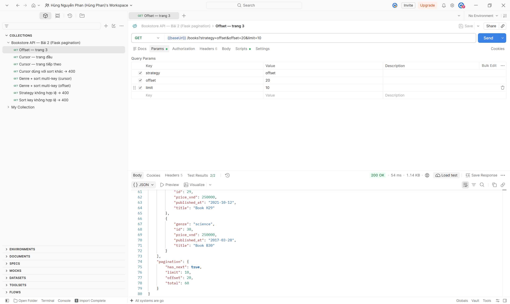
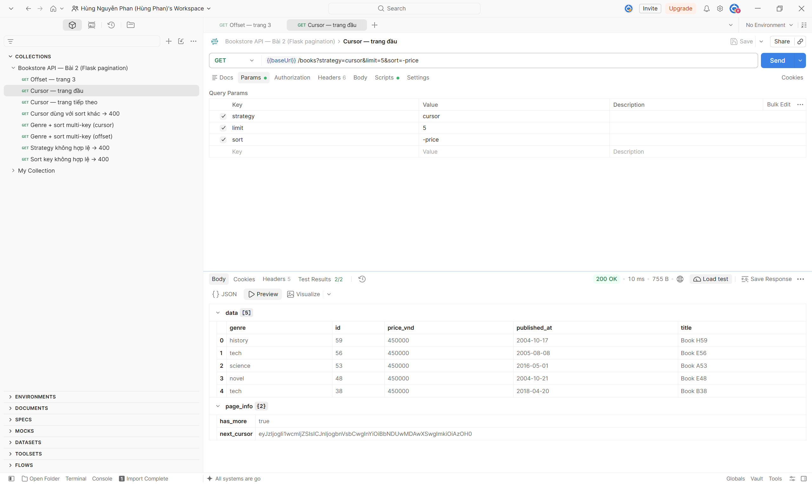
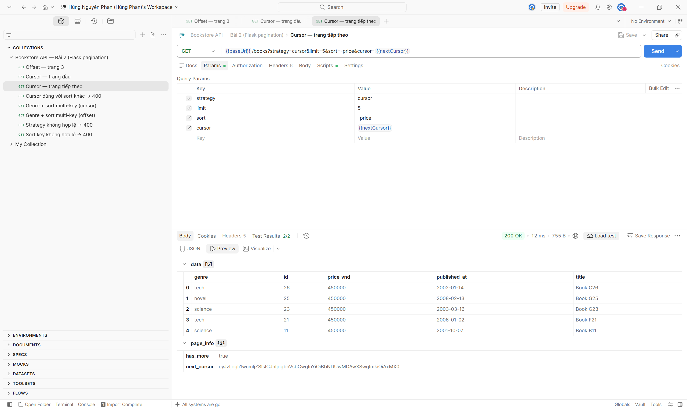
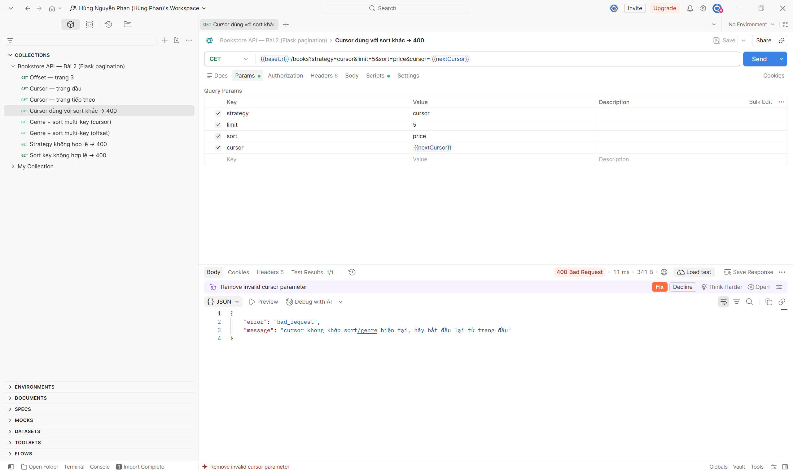
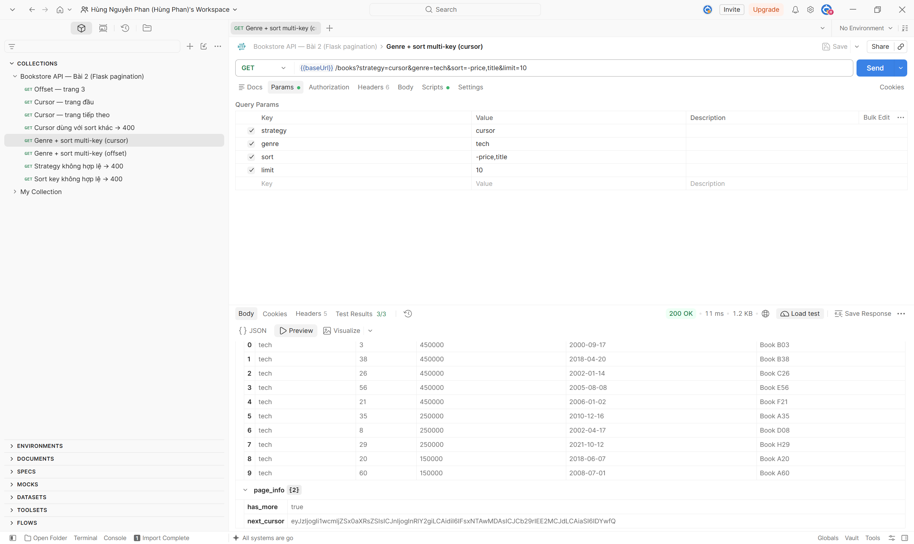
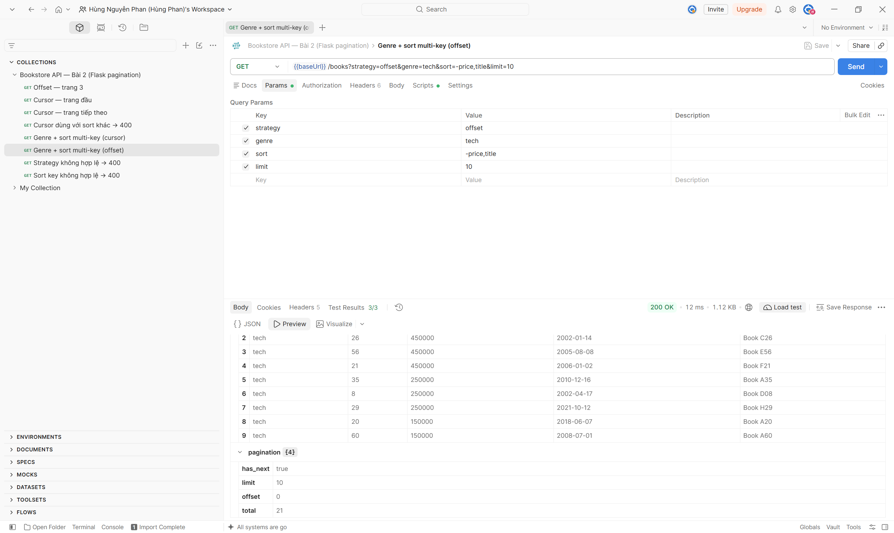
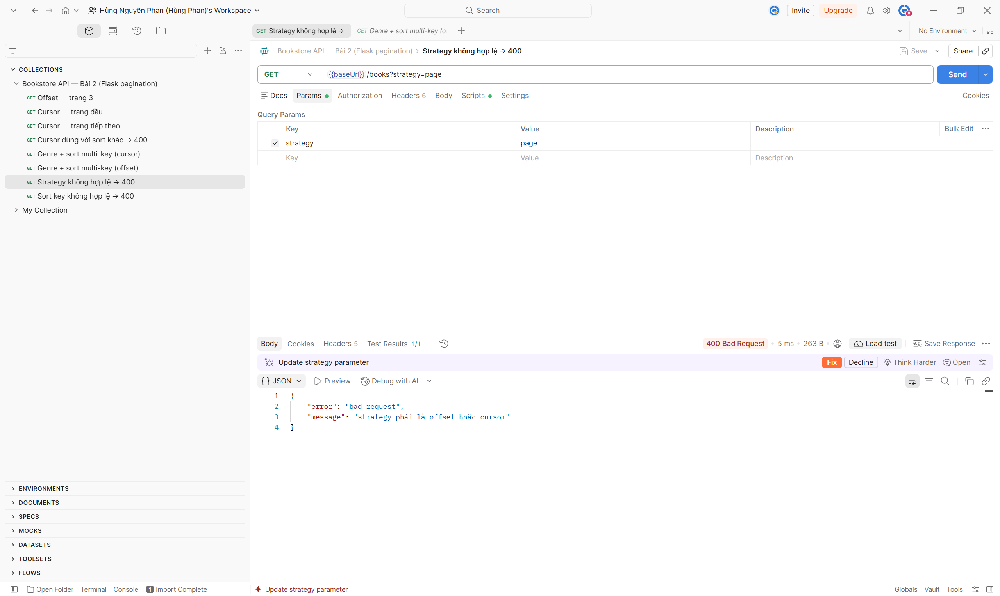
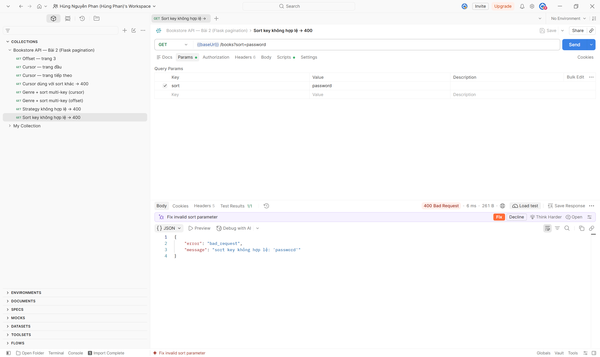
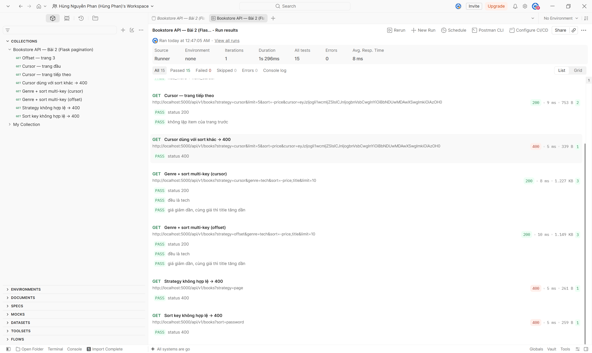

# Bookstore API — Bài 2: Flask pagination

Hoàn thiện `list_books` (`GET /api/v1/books`) ở Lab 1:

- **Offset và cursor**, chọn qua `?strategy=offset|cursor` (mặc định `offset`).
- **Filter** `?genre=tech` hoặc nhiều thể loại `?genre=tech,novel`.
- **Sort multi-key** `?sort=-price,title` (`-` = giảm dần). Khoá hợp lệ: `id`, `title`, `price`, `published`.

## Chạy

```bash
python -m venv venv
venv\Scripts\activate              # macOS/Linux: source venv/bin/activate
pip install -r requirements.txt
flask --app app init-db            # tạo bảng + 60 sách mẫu (giá cố ý trùng nhiều)
flask --app app run                # http://localhost:5000/api/v1/books
pytest -v                          # chạy tests
```

Postman: import `postman_collection.json`, chuột phải vào collection, chọn **Run collection** (chạy theo thứ tự).

## Cấu trúc

```
app.py                   app factory, lệnh init-db, dữ liệu mẫu
models.py                Book (to_dict), Category
routes/books.py          list_books: offset, cursor, genre, sort multi-key
schemas/book.json        JSON Schema của một Book trong response
test_books.py            pytest
postman_collection.json  8 request, 15 test script
screenshots/             ảnh kết quả test bằng Postman
```

## Response

Offset:

```json
{"data": [...], "pagination": {"offset": 20, "limit": 10, "total": 60, "has_next": true}}
```

Cursor:

```json
{"data": [...], "page_info": {"next_cursor": "eyJz...", "has_more": true}}
```

`next_cursor` là base64 của `{"s": sort, "g": genre, "v": [giá trị các khoá sort], "i": id}`. `id` luôn là khoá tie-break cuối cùng, nên khi nhiều sách trùng giá, thứ tự vẫn xác định và không bị sót hay lặp. Cursor gắn với `sort` và `genre` lúc tạo, đổi một trong hai giữa chừng thì trả 400.

## Kết quả test bằng Postman

### 1. Offset: `?strategy=offset&offset=20&limit=10`



`200 OK`. Trả 10 sách, id từ 21 đến 30 (cuối danh sách là id 29, 30). `pagination` = `{offset: 20, limit: 10, total: 60, has_next: true}`. Test 2/2.

### 2. Cursor, trang đầu: `?strategy=cursor&limit=5&sort=-price`



`200 OK`. Cả 5 sách đều giá cao nhất là 450000 nên phải xếp phụ theo id giảm dần: 59, 56, 53, 48, 38. `page_info.has_more = true` và có `next_cursor`. Test 2/2.

### 3. Cursor, trang tiếp theo: thêm `&cursor={{nextCursor}}`



`200 OK`. Trang tiếp nối ngay sau sách id 38: 26, 25, 23, 21, 11, vẫn cùng giá 450000. Không sách nào trùng trang 1, chứng tỏ cursor nhớ đúng cả giá lẫn id. Test 2/2.

### 4. Cursor dùng với sort khác: `sort=price` + cursor của `sort=-price`



`400 Bad Request`, message: `cursor không khớp sort/genre hiện tại, hãy bắt đầu lại từ trang đầu`. Test 1/1.

### 5. Genre + sort multi-key, cursor: `?strategy=cursor&genre=tech&sort=-price,title&limit=10`



`200 OK`. Cả 10 sách đều `genre = tech`. Giá giảm dần, sách cùng giá xếp theo title tăng dần:

- 450000: B03, B38, C26, E56, F21
- 250000: A35, D08, H29
- 150000: A20, A60

`has_more = true`. Test 3/3.

### 6. Genre + sort multi-key, offset: như ảnh 5, nhưng `strategy=offset`



`200 OK`. Thứ tự giống hệt ảnh 5, nghĩa là hai cách phân trang cho cùng kết quả. `pagination` = `{offset: 0, limit: 10, total: 21, has_next: true}`, tức có 21 sách thể loại tech. Test 3/3.

### 7. Strategy không hợp lệ: `?strategy=page`



`400 Bad Request`, message: `strategy phải là offset hoặc cursor`. Test 1/1.

### 8. Sort key không hợp lệ: `?sort=password`



`400 Bad Request`, message: `sort key không hợp lệ: 'password'`. Chỉ các khoá trong danh sách cho phép mới được sort, nên không lộ hay sort được theo cột bất kỳ. Test 1/1.

### 9. Chạy cả collection (Collection Runner)



8 request, **15/15 test passed**, 0 failed, 0 error. Thời gian phản hồi trung bình 8 ms.
