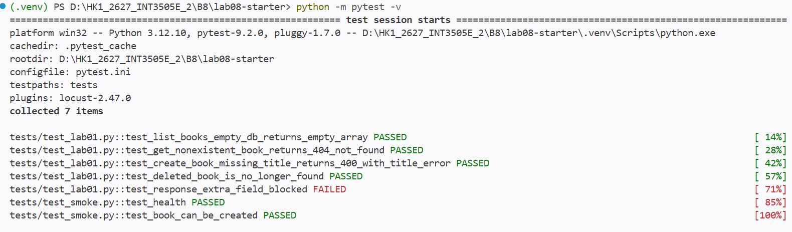
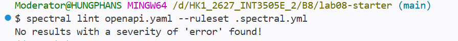
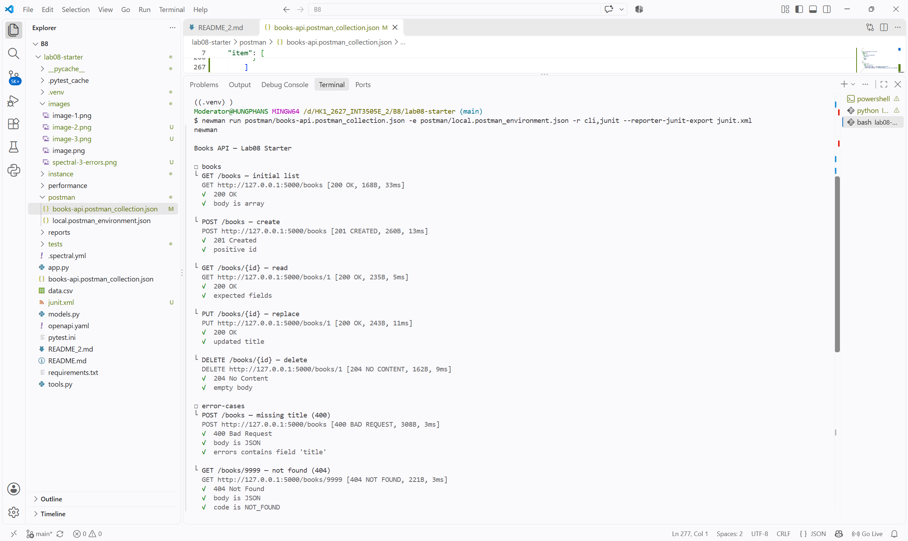

## Lab 1 - test with 4 tests in step 1

4 required tests in `tests/test_lab01.py` + 2 smoke tests: 6 passed in 0.47s.

## Lab 1 - test with bonus in step 2, failed resulted in error in Lab2

`test_response_extra_field_blocked` failed because `Book.year` in openapi.yaml is `type: string` (error 3 of Lab 2), while the API returns an integer.

## Lab 2 - spectral with default rules for openapi.yaml

14 warnings, 0 errors. Only the 1st error in slide (`GET /books` missing `operationId`) is reported, and only as a warning. Errors 2 and 3 are not detected.

## Lab 2 - spectral added 3 rules for openapi.yaml

All 3 errors in slide reported as errors:
- `operation-operationId` (raised to error): `GET /books` missing `operationId`
- `no-body-on-204`: response 204 of `DELETE /books/{id}` has `content`
- `year-must-be-integer`: `Book.year` is not `integer`

Style rules `info-contact`, `operation-description`, `operation-tags` turned off. Custom rule `response-200-has-properties` added: schema of response 200 must have at least 1 field.

No error catched after openapi.yaml fixed.

## Lab 3 - Newman added error cases - result

Added folder `error-cases/` (POST missing title → 400, GET /books/9999 → 404). 7 requests, 16 assertions, 0 failed, 633ms. JUnit report: `reports/junit.xml`.

## Lab 4 - Locust

Added task `search_by_year` with 1% simulated failure (client-side `response.failure()`, not real HTTP 500 from server). Reports: `reports/A.html`, `reports/B.html`, `reports/C.html`. Analysis: `performance/analysis.md`.