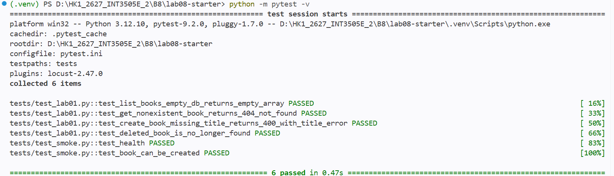
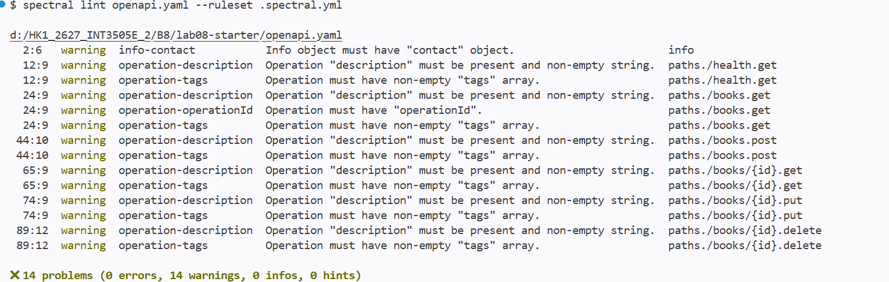
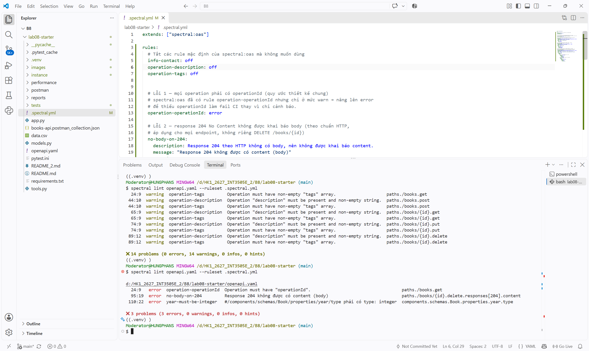
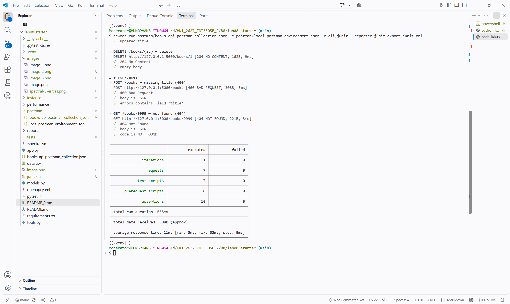

## test with 4 tests in step 1

## test with bonus in step 2, failed resulted in error in Lab2

## spectral with default rules for openapi.yaml

No errors, only warnings, 1st error in slide reported as warning

## spectral added 3 rules for openapi.yaml

All 3 errors in slide reported

No error catched after openapi.yaml fixed

## Newman added error cases - result

No scripts failed